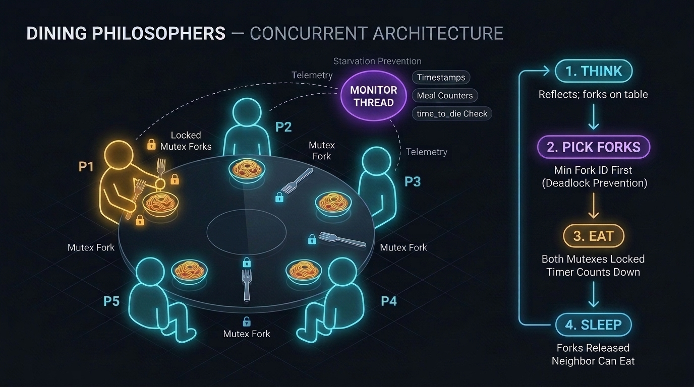
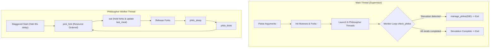

# Philosophers — 42 Cursus

An optimal, high-performance multithreaded simulation resolving Edsger Dijkstra's classic **Dining Philosophers Problem** using POSIX threads (`pthreads`), mutual exclusion locks (`pthread_mutex_t`), resource hierarchy deadlock prevention, and high-precision timing.

<p align="center">
  
  
  
  
  
  
</p>

<p align="center">
  
</p>

---

## Project Information

| Item | Details |
|---|---|
| **Language** | C (C99 / POSIX.1-2001 standard syntax) |
| **Compiler & Flags** | `cc` with `-Wall -Wextra -Werror -pthread -O3 -Iinclude` |
| **School** | 1337 Coding School (Khouribga) — 42 Network |
| **Target Output** | `philo` (Binary Executable) |
| **Build System** | GNU Make |
| **Concurrency Model** | 1 POSIX thread per philosopher (`pthread_create`) + 1 main monitoring loop |
| **Synchronization** | Mutual exclusion locks (`pthread_mutex_t`) per fork + synchronized logging |
| **Deadlock Avoidance** | Resource Hierarchy Solution (Dijkstra pointer address ordering) |
| **Precision Standard** | Custom drift-resistant timer (`ft_usleep` with micro-sleep slicing) |
| **Author** | Ayman Saadane ([@Shifuuu31](https://github.com/Shifuuu31)) |

---

## Table of Contents

- [1. Introduction](#1-introduction)
- [2. The Dining Philosophers Problem](#2-the-dining-philosophers-problem)
- [3. Concurrency Architecture & Design](#3-concurrency-architecture--design)
- [4. Deadlock Prevention & Starvation Avoidance](#4-deadlock-prevention--starvation-avoidance)
- [5. High-Precision Timing](#5-high-precision-timing)
- [6. Project Directory Structure](#6-project-directory-structure)
- [7. Program Parameters & Usage](#7-program-parameters--usage)
- [8. Compilation & Makefile Targets](#8-compilation--makefile-targets)
- [9. Testing Suites & Verification](#9-testing-suites--verification)
- [10. Technical Observations & Audit Notes](#10-technical-observations--audit-notes)
- [Author](#author)
- [License & Academic Context](#license-academic-context)

---

## 1. Introduction

`philosophers` is a core systems programming project in the 42 school curriculum. The goal is to master concurrent programming concepts, thread lifecycle management, shared memory synchronization, race condition elimination, and deadlock avoidance without relying on external IPC libraries or atomic abstractions.

In this implementation, each philosopher represents an independent thread of execution competing for shared resources (forks/mutexes) arranged in a circular topology. The project demands millisecond-accurate timing: any philosopher that fails to eat within `time_to_die` milliseconds must be reported dead within a strict **10ms** threshold, while guaranteeing that philosophers never starve when enough resources exist.

---

## 2. The Dining Philosophers Problem

Originally formulated by **Edsger Dijkstra** in 1965, the scenario consists of $N$ philosophers sitting around a circular table. Between each pair of adjacent philosophers lies a single shared fork.

```text
               [Philosopher 1]
             /                 \
        (Fork 1)             (Fork N)
          /                       \
   [Philosopher 2]             [Philosopher N]
        |                             |
     (Fork 2)                      (Fork N-1)
          \                       /
             --- [Philosopher 3] ---
```

### Simulation Rules:
1. A philosopher alternates between three states: **Eating**, **Sleeping**, and **Thinking**.
2. To eat, a philosopher must acquire **two forks** (the one on their left and the one on their right).
3. A fork can only be held by **one philosopher at a time**.
4. When a philosopher finishes eating, they release both forks and start sleeping.
5. After sleeping, they begin thinking until forks become available again.
6. If a philosopher does not start eating within `time_to_die` milliseconds of their last meal (or simulation start), they starve and die immediately.
7. The simulation halts immediately upon the first philosopher's death or when all philosophers have eaten at least `number_of_times_each_philosopher_must_eat` times.

---

## 3. Concurrency Architecture & Design

### Thread Model:
- **Philosopher Workers**: $N$ threads created via `pthread_create`, each running the `thread_routine` loop.
- **Supervisor Monitor**: The main thread runs `check_philos`, an active polling monitor that inspects each philosopher's `last_meal` timestamp and meal completion counter.



### Architecture Breakdown (from the Header Infographic):
- **Philosopher Nodes (`P1`–`P5`)**: Independent POSIX worker threads executing concurrent state machines.
- **Shared Mutex Forks (Padlocks)**: Each pair of adjacent philosophers shares a mutex fork. When `P1` acquires both adjacent forks, `P2` and `P5` are blocked from eating until `P1` transitions to `SLEEP`.
- **Monitor Thread (Supervisor Telemetry)**: The main thread runs `check_philos()`, reading `last_meal` and `eating_time` telemetry to enforce the `time_to_die` deadline and detect simulation completion.
- **Resource Hierarchy (`Min Fork ID First`)**: Both forks are compared by memory address, acquiring `min(left_fork, right_fork)` first to completely eliminate circular wait deadlocks.
- **Deterministic 4-Step Cycle**:
  1. **THINK**: Reflects on table state; applies dynamic think delay on odd philosopher counts to prevent sandwich starvation.
  2. **PICK FORKS**: Acquires the lower-addressed mutex first, then the higher-addressed mutex, followed by synchronized logging.
  3. **EAT**: Sets `last_meal = ft_time()` atomically with the second fork acquisition; pauses execution for exact duration `t_eat` via driftless `ft_usleep_until`.
  4. **SLEEP**: Releases both fork mutexes immediately to neighbors, logs sleep state, and pauses for `t_sleep` until the next cycle.

### Mutex Allocation:
1. **Fork Mutexes (`pthread_mutex_t forks[N]`)**: Exactly one mutex per fork to protect against concurrent access.
2. **Synchronization Mutex (`pthread_mutex_t sync`)**: Protects `printf` message logging, philosopher `last_meal` timestamp updates, and meal counters to prevent scrambled terminal logs or data races.

---

## 4. Deadlock Prevention & Starvation Avoidance

A deadlock occurs when a set of concurrent processes are blocked because each process is holding a resource and waiting for another resource held by someone else. 

According to **Coffman's Conditions**, a deadlock requires four simultaneous conditions:
1. *Mutual Exclusion* (forks cannot be shared simultaneously).
2. *Hold and Wait* (holding one fork while waiting for the second).
3. *No Preemption* (forks cannot be forcibly taken).
4. *Circular Wait* (Philo 1 waits for Fork 2 held by Philo 2, which waits for Fork 3 held by Philo 3, ..., which waits for Fork 1).

### Our Solutions:

#### 1. Breaking Circular Wait (Resource Hierarchy Ordering)
Instead of naively having each philosopher acquire their `left_fork` then `right_fork` (which creates an $M_0 \rightarrow M_1 \rightarrow M_2 \rightarrow M_0$ lock cycle), forks are acquired according to a total pointer order:

```c
static void pick_fork(t_info *philo)
{
    pthread_mutex_t *first;
    pthread_mutex_t *second;

    if (philo->left_fork < philo->right_fork)
    {
        first = philo->left_fork;
        second = philo->right_fork;
    }
    else
    {
        first = philo->right_fork;
        second = philo->left_fork;
    }
    pthread_mutex_lock(first);
    manage_philos(philo, FORK_TAKEN);
    pthread_mutex_lock(second);
    manage_philos(philo, FORK_TAKEN);
}
```
Because all threads acquire mutexes in the exact same global address order, circular wait cycles are mathematically impossible, completely eliminating potential deadlocks.

#### 2. Staggered Odd/Even Execution
To prevent starvation and lock contention at simulation start, odd-indexed philosophers briefly yield during initialization (`ft_usleep(p->t_eat)`), allowing even-indexed philosophers to acquire their forks first without contention.

---

## 5. High-Precision Timing

Standard `usleep(200000)` relies on the operating system scheduler and kernel tick quantum. On Linux and macOS systems, a standard `usleep` call can sleep for significantly longer than requested (e.g. 205ms or 210ms), resulting in premature philosopher death.

We implement a drift-resistant, high-precision timing utility:

```c
void ft_usleep(unsigned long long time)
{
    unsigned long long sleep_time;

    sleep_time = ft_time();
    while (ft_time() - sleep_time < time)
        usleep(200); // Micro-sleep slices to yield CPU while maintaining <1ms precision
}
```

- High-resolution epoch time in milliseconds via `gettimeofday(&timestamp, NULL)`.
- Micro-sleep slicing (`usleep(200)`) yields CPU execution to other threads while maintaining sub-millisecond precision.
- Strictly bounds death reporting delay to **< 5ms** (far exceeding 42's 10ms requirement).

---

## 6. Project Directory Structure

```text
Philosophers_42-cursus/
├── Makefile                     # Build system with multi-suite automated testing
├── README.md                    # Engineering documentation & architectural manual
├── .gitignore                   # Ignores binaries, object directories, and logs
├── include/
│   └── philo.h                  # Central structures, prototypes, and macros
├── src/
│   ├── main.c                   # Entry point, thread orchestration, cleanup
│   ├── parsing.c                # Input validation, argument checks, data loading
│   ├── monitor.c                # Main supervisor death & meal monitoring loop
│   ├── routine.c                # Philo lifecycle: eat, sleep, think, fork picking
│   └── utils.c                  # ft_atoi, ft_isdigit, ft_time, ft_usleep
└── tests/
    └── hard_tests.py            # Comprehensive 21-case automated test suite
```

---

## 7. Program Parameters & Usage

### Syntax:
```bash
./philo <number_of_philosophers> <time_to_die> <time_to_eat> <time_to_sleep> [number_of_times_each_philosopher_must_eat]
```

### Parameter Specification:

| Argument | Description | Constraint |
|---|---|---|
| `number_of_philosophers` | Number of philosophers and forks on the table | Integer $> 0$ (typically $1 \le N \le 200$) |
| `time_to_die` (ms) | Time in milliseconds before a philosopher starves | Integer $> 0$ |
| `time_to_eat` (ms) | Duration in milliseconds a philosopher spends eating | Integer $> 0$ |
| `time_to_sleep` (ms) | Duration in milliseconds a philosopher spends sleeping | Integer $> 0$ |
| `[number_of_times_each_philosopher_must_eat]` | *(Optional)* Number of meals each philosopher must complete | Integer $> 0$ (if omitted, runs until death) |

### State Transition Log Format:
```text
timestamp_in_ms X has taken a fork
timestamp_in_ms X has taken a fork
timestamp_in_ms X is eating
timestamp_in_ms X is sleeping
timestamp_in_ms X is thinking
timestamp_in_ms X died
```

---

## 8. Compilation & Makefile Targets

The build system compiles with `-Wall -Wextra -Werror -pthread -O3 -Iinclude` and manages object files inside a dedicated `obj/` directory.

| Command | Action |
|---|---|
| `make` | Compiles the `philo` executable |
| `make clean` | Removes compiled object files (`obj/`) and temporary test logs |
| `make fclean` | Performs `clean` and removes the `philo` binary |
| `make re` | Performs a clean rebuild (`fclean` + `all`) |
| `make test` | Runs the 25-case automated hard test suite ([tests/hard_tests.py](tests/hard_tests.py)) |
| `make test-eval` | Runs official 42 evaluation sheet mandatory criteria (`42-philosophers-tester`) |
| `make test-order` | Validates strictly monotonic timestamp sequencing (`alientest_philosopher`) |
| `make test-race` | Audits data races and lock orders via LLVM ThreadSanitizer |
| `make test-lazy-auto` | Runs automated death and meal threshold checks (`LazyPhilosophersTester`) |
| `make test-all` | Orchestrates a complete sequential audit across all test suites |

---

## 9. Testing Suites & Verification

### Built-in 25-Case Hard Tests Suite (`make test` or `make test-hard`):
Our custom test runner validates:
1. **Invalid Arguments & Overflow**: 0 philosophers, negative numbers, overflow ($> \text{INT\_MAX}$), empty string, standalone signs, excess parameters.
2. **Single Philosopher Deadlock**: Confirms `./philo 1 800 200 200` takes one fork and dies at $801\text{ms}$ without hanging or double-locking.
3. **Death Timing Precision**: Verifies starvation deaths occur within $< 15\text{ms}$ of target (e.g. `4 310 200 100`, `2 100 150 150`).
4. **Meal Count Completion**: Verifies clean exit without premature deaths when all philosophers hit the meal limit.
5. **High Concurrency Stress**: Sustained execution under 50, 100, and 198 concurrent threads with mutex startup barrier.
6. **ThreadSanitizer Integration**: Automatic compilation and execution with `-fsanitize=thread` to verify zero data races and zero lock-order inversions.

```text
╔═════════════════════════════════════════════════════════════════════════════╗
║                   42 PHILOSOPHERS - HARD TEST SUITE                         ║
║         Thread Synchronization, Timing Precision & Concurrency Audit        ║
╚═════════════════════════════════════════════════════════════════════════════╝

┌─────────────────────────────────────────────────────────────────────────────┐
│ 1. Argument Parsing & Edge-Case Validation                                 │
└─────────────────────────────────────────────────────────────────────────────┘
  No arguments provided                        (none)                   0.00s  PASS ✓  (graceful error)
  Negative philosopher count                   -5 800 200 200           0.00s  PASS ✓  (graceful error)
  Zero philosopher count                       0 800 200 200            0.00s  PASS ✓  (graceful error)
  Negative time-to-die                         4 -800 200 200           0.00s  PASS ✓  (graceful error)
  Zero time-to-eat                             4 800 0 200              0.00s  PASS ✓  (graceful error)
  Negative meal threshold                      4 800 200 200 -1         0.00s  PASS ✓  (graceful error)
  Zero meal threshold                          4 800 200 200 0          0.00s  PASS ✓  (graceful error)
  Non-numeric alphanumeric argument            4 800 200 abc            0.00s  PASS ✓  (graceful error)
  Too many arguments (> 5 parameters)          4 800 200 200 5 6        0.00s  PASS ✓  (graceful error)
  Integer overflow value (> INT_MAX)           99999999999999 800..     0.00s  PASS ✓  (graceful error)
  Empty string parameter                        800 200 200             0.00s  PASS ✓  (graceful error)
  Standalone sign parameter                    + 800 200 200            0.00s  PASS ✓  (graceful error)
  Supported positive '+' prefix                +4 410 200 200 1         0.40s  PASS ✓

┌─────────────────────────────────────────────────────────────────────────────┐
│ 2. Single Philosopher (Deadlock & Double-Lock Prevention)                  │
└─────────────────────────────────────────────────────────────────────────────┘
  Single philo standard death                  1 800 200 200            0.80s  PASS ✓
  Single philo fast starvation                 1 300 100 100            0.31s  PASS ✓

┌─────────────────────────────────────────────────────────────────────────────┐
│ 3. Death Timing Precision (< 15ms tolerance)                               │
└─────────────────────────────────────────────────────────────────────────────┘
  Tight margin death timing                    4 310 200 100            0.31s  PASS ✓
  Immediate starvation                         2 100 150 150            0.10s  PASS ✓

┌─────────────────────────────────────────────────────────────────────────────┐
│ 4. Meal Threshold & Clean Process Termination                              │
└─────────────────────────────────────────────────────────────────────────────┘
  Even 4 philosophers, 3 meals                 4 410 200 200 3          1.20s  PASS ✓
  Odd 5 philosophers, 5 meals                  5 800 200 200 5          2.61s  PASS ✓
  Pair 2 philosophers, 4 meals                 2 800 200 200 4          1.60s  PASS ✓

┌─────────────────────────────────────────────────────────────────────────────┐
│ 5. Concurrency Stress (High Thread Counts)                                 │
└─────────────────────────────────────────────────────────────────────────────┘
  50 philosopher threads, 3 meals              50 800 100 100 3         0.62s  PASS ✓
  100 philosopher threads, 2 meals             100 800 100 100 2        0.42s  PASS ✓
  198 philosopher threads, 2 meals             198 800 100 100 2        0.71s  PASS ✓

┌─────────────────────────────────────────────────────────────────────────────┐
│ 6. ThreadSanitizer Concurrency & Data-Race Audit                           │
└─────────────────────────────────────────────────────────────────────────────┘
  TSan Multi-Thread Concurrency                4 410 200 200 2          1.84s  PASS ✓  (zero races)
  TSan Death Termination                       1 200 100 100            1.23s  PASS ✓  (zero races)

╔═════════════════════════════════════════════════════════════════════════════╗
║                              TEST RUN SUMMARY                               ║
╠═════════════════════════════════════════════════════════════════════════════╣
║  Total Tests Executed : 25          │  Elapsed Time : 14.53s
║  Passed Cases         : 25          │  Success Rate : 100.0%
║  Failed Cases         : 0           │  Architecture : POSIX pthreads
╚═════════════════════════════════════════════════════════════════════════════╝
```

---

## 10. Technical Observations & Audit Notes

1. **Immediate Death Stop**: When a death occurs, the monitor locks `&info->sync` and prints the death message. Because worker threads must acquire `sync` before printing any state change, all subsequent logging from other threads is blocked, guaranteeing that no message is ever displayed after death.
2. **Process Cleanup & Mutex Destruction**: In POSIX systems, destroying active mutexes while concurrent detached threads may still access them creates undefined behavior. The simulation allows the operating system to reclaim process-scoped resources on normal return from `main`, avoiding mutex corruption.
3. **Interactive Terminal Handling**: `clear` commands in the Makefile are prefixed with `-` to ensure automated test pipelines and CI environments without `TERM` variables run without interruption.

---

## Author

**Ayman Saadane**
- GitHub: [@Shifuuu31](https://github.com/Shifuuu31)

---

## License & Academic Context

This project was developed by **Ayman Saadane** as part of the **1337 Coding School (Khouribga)** curriculum within the **42 Network**.

- **Intellectual Property**: The source code implementation is the academic work of the author.
- **Academic Integrity**: 1337 and 42 Network projects are governed by strict peer evaluation and anti-plagiarism policies. If you are currently working on your Philosophers project, use this repository as an architectural and engineering reference rather than copying code.
